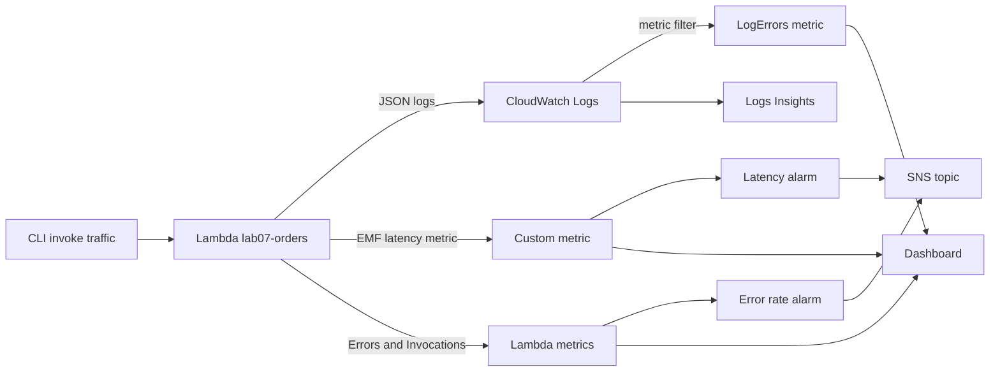

## Overview

You will build a monitoring baseline around a small order-processing Lambda function: structured JSON logs, a custom latency metric published through the CloudWatch Embedded Metric Format, a metric filter that turns error logs into a metric, a metric-math **error-rate alarm**, a latency alarm, a dashboard, and Logs Insights queries. Then you will generate good, failing, and slow traffic and watch the alarms fire — the detect-and-investigate loop behind the [Observability & Monitoring](../../scenarios/observability/) playbook.

- **Difficulty:** Beginner
- **Estimated time:** 1–1.5 hours
- **Estimated cost:** Under $0.25. Lambda and logging volumes are tiny, and the lab's custom metrics, alarms, and dashboard fit inside the CloudWatch free tier for most accounts. Metric-math alarms are billed per metric in the expression, so check your free-tier usage if the account runs other alarms.

Companion pattern: [Observability & Monitoring](../../scenarios/observability/).


Alarms and log groups keep existing until you delete them, and a log group with no retention policy stores data forever. Run the **Teardown** section and the final verification checks when you finish.


## Architecture



## Prerequisites

- AWS CLI v2 configured — see [Getting Started](../getting-started/).
- Region assumption: **us-east-1** (the dashboard JSON below hard-codes it).
- `python3` and `zip` available locally.

## Build steps

{}

### Create the log group with a retention policy

Creating the log group yourself, before the function exists, lets you set retention up front. Lambda reuses an existing group of the right name.

```bash
ACCOUNT_ID=$(aws sts get-caller-identity --query Account --output text)
LOG_GROUP=/aws/lambda/lab07-orders

aws logs create-log-group --log-group-name $LOG_GROUP
aws logs put-retention-policy --log-group-name $LOG_GROUP --retention-in-days 7
```

Seven days is plenty for a lab, and the habit of setting retention is one of the cheapest cost controls in CloudWatch.

### Write the instrumented Lambda function

The handler emits **structured JSON logs** with the request ID, and publishes an `OrderLatencyMs` metric using the Embedded Metric Format (EMF) — a JSON log line that CloudWatch converts into a metric automatically. Passing `mode` in the test event lets you trigger a failure or a slow response on demand.

```bash
mkdir -p /tmp/lab07 && cd /tmp/lab07

cat > orders.py <<'EOF'
import json
import time


def log(level, msg, ctx, **fields):
    print(json.dumps({"level": level, "msg": msg,
                      "request_id": ctx.aws_request_id, **fields}))


def emit_latency(ms):
    print(json.dumps({
        "_aws": {
            "Timestamp": int(time.time() * 1000),
            "CloudWatchMetrics": [{
                "Namespace": "Lab07/Orders",
                "Dimensions": [["Service"]],
                "Metrics": [{"Name": "OrderLatencyMs", "Unit": "Milliseconds"}],
            }],
        },
        "Service": "orders",
        "OrderLatencyMs": ms,
    }))


def handler(event, context):
    start = time.time()
    order_id = event.get("order_id", "unknown")
    mode = event.get("mode", "ok")
    try:
        if mode == "slow":
            time.sleep(1.5)
        if mode == "fail":
            raise RuntimeError("payment provider timeout")
        log("INFO", "order processed", context, order_id=order_id)
        return {"status": "ok", "order_id": order_id}
    except Exception as exc:
        log("ERROR", str(exc), context, order_id=order_id)
        raise
    finally:
        emit_latency(round((time.time() - start) * 1000, 1))
EOF

zip orders.zip orders.py
```

### Deploy the function

```bash
aws iam create-role --role-name lab07-orders-role \
  --assume-role-policy-document '{
    "Version": "2012-10-17",
    "Statement": [{
      "Effect": "Allow",
      "Principal": {"Service": "lambda.amazonaws.com"},
      "Action": "sts:AssumeRole"
    }]
  }'
aws iam attach-role-policy --role-name lab07-orders-role \
  --policy-arn arn:aws:iam::aws:policy/service-role/AWSLambdaBasicExecutionRole
sleep 10

aws lambda create-function --function-name lab07-orders \
  --runtime python3.12 --handler orders.handler \
  --zip-file fileb://orders.zip \
  --role arn:aws:iam::$ACCOUNT_ID:role/lab07-orders-role \
  --timeout 10 \
  --tags Project=aws-sol-lab,Lab=lab-07
aws lambda wait function-active --function-name lab07-orders
```

### Turn error logs into a metric

A **metric filter** counts log lines matching a JSON pattern and publishes the count as a metric. This is how you alarm on conditions that only exist in your logs.

```bash
aws logs put-metric-filter --log-group-name $LOG_GROUP \
  --filter-name lab07-errors \
  --filter-pattern '{ $.level = "ERROR" }' \
  --metric-transformations \
    metricName=LogErrors,metricNamespace=Lab07/Orders,metricValue=1,defaultValue=0
```

### Create the notification topic

```bash
TOPIC_ARN=$(aws sns create-topic --name lab07-alerts \
  --query 'TopicArn' --output text)

# Optional: receive the alarm by email (you must confirm the subscription)
# aws sns subscribe --topic-arn $TOPIC_ARN --protocol email \
#   --notification-endpoint you@example.com
```

The alarms work with or without a subscriber; the topic shows where paging would plug in.

### Create the alarms

The first alarm uses **metric math** to compute an error rate from two Lambda metrics — alarming on a ratio is closer to how real SLO alerts work than alarming on a raw count. The `IF` guard avoids dividing by zero when there is no traffic.

```bash
aws cloudwatch put-metric-alarm --alarm-name lab07-error-rate \
  --alarm-description "Order Lambda error rate above 5 percent" \
  --metrics '[
    {"Id":"errors","ReturnData":false,"MetricStat":{"Metric":{"Namespace":"AWS/Lambda","MetricName":"Errors","Dimensions":[{"Name":"FunctionName","Value":"lab07-orders"}]},"Period":60,"Stat":"Sum"}},
    {"Id":"invocations","ReturnData":false,"MetricStat":{"Metric":{"Namespace":"AWS/Lambda","MetricName":"Invocations","Dimensions":[{"Name":"FunctionName","Value":"lab07-orders"}]},"Period":60,"Stat":"Sum"}},
    {"Id":"rate","Label":"ErrorRatePercent","ReturnData":true,"Expression":"IF(invocations > 0, 100 * errors / invocations, 0)"}
  ]' \
  --evaluation-periods 1 --datapoints-to-alarm 1 \
  --threshold 5 --comparison-operator GreaterThanThreshold \
  --treat-missing-data notBreaching \
  --alarm-actions $TOPIC_ARN

aws cloudwatch put-metric-alarm --alarm-name lab07-latency \
  --alarm-description "Order latency above 1000 ms" \
  --namespace Lab07/Orders --metric-name OrderLatencyMs \
  --dimensions Name=Service,Value=orders \
  --statistic Maximum --period 60 \
  --evaluation-periods 1 --datapoints-to-alarm 1 \
  --threshold 1000 --comparison-operator GreaterThanThreshold \
  --treat-missing-data notBreaching \
  --alarm-actions $TOPIC_ARN
```

The latency alarm uses `Maximum` so the lab's handful of requests trips it reliably. In production you would alarm on a percentile such as p99 over a larger sample.

### Build the dashboard

```bash
cat > dashboard.json <<'EOF'
{
  "widgets": [
    {"type": "metric", "x": 0, "y": 0, "width": 12, "height": 6,
     "properties": {"title": "Invocations, errors, and log errors", "region": "us-east-1",
       "stat": "Sum", "period": 60,
       "metrics": [
         ["AWS/Lambda", "Invocations", "FunctionName", "lab07-orders"],
         ["AWS/Lambda", "Errors", "FunctionName", "lab07-orders"],
         ["Lab07/Orders", "LogErrors"]
       ]}},
    {"type": "metric", "x": 12, "y": 0, "width": 12, "height": 6,
     "properties": {"title": "Order latency in ms", "region": "us-east-1",
       "stat": "Maximum", "period": 60,
       "metrics": [["Lab07/Orders", "OrderLatencyMs", "Service", "orders"]]}},
    {"type": "log", "x": 0, "y": 6, "width": 24, "height": 6,
     "properties": {"title": "Recent errors", "region": "us-east-1", "view": "table",
       "query": "SOURCE '/aws/lambda/lab07-orders' | fields @timestamp, order_id, msg | filter level = \"ERROR\" | sort @timestamp desc | limit 20"}}
  ]
}
EOF

aws cloudwatch put-dashboard --dashboard-name lab07-orders \
  --dashboard-body file://dashboard.json
```

### Generate traffic

Send healthy, failing, and slow orders. The failures arrive back to back so that at least one one-minute window crosses the 5 percent error-rate threshold.

```bash
send() {
  aws lambda invoke --function-name lab07-orders \
    --cli-binary-format raw-in-base64-out \
    --payload "{\"order_id\":\"$1\",\"mode\":\"$2\"}" \
    /dev/null > /dev/null
}

for i in $(seq 1 20); do send "ok-$i" ok; done
for i in $(seq 1 8);  do send "bad-$i" fail; done
for i in 1 2 3;       do send "slow-$i" slow; done
echo "traffic sent"
```

A failing invocation returns a `FunctionError` field in the response, which the script discards; the failure still counts in the Lambda `Errors` metric.

{}

## Verify

**Alarms fire.** Metrics take a minute or two to arrive and alarms evaluate each minute, so wait about three minutes, then check:

```bash
sleep 180
aws cloudwatch describe-alarms \
  --alarm-names lab07-error-rate lab07-latency \
  --query 'MetricAlarms[].[AlarmName,StateValue]' --output table
```

Both alarms in `ALARM` state proves the chain from your code to a notification decision. If one still shows `OK` or `INSUFFICIENT_DATA`, wait another minute and re-run.

**Metrics exist.** Confirm both the EMF metric and the log-derived metric were created:

```bash
aws cloudwatch list-metrics --namespace Lab07/Orders \
  --query 'Metrics[].MetricName' --output text
```

You should see `OrderLatencyMs` and `LogErrors`.

**Investigate with Logs Insights.** Group the failures by message to see what broke:

```bash
QID=$(aws logs start-query --log-group-name $LOG_GROUP \
  --start-time $(($(date +%s) - 1800)) --end-time $(date +%s) \
  --query-string 'fields @timestamp, order_id, msg | filter level = "ERROR" | stats count() as failures by msg' \
  --query 'queryId' --output text)
sleep 5
aws logs get-query-results --query-id $QID
```

A result row showing `payment provider timeout` with a count of `8` is the success criterion — structured logs turned eight scattered log lines into one answer. Open the `lab07-orders` dashboard in the CloudWatch console to see the error spike, the latency jump from the slow requests, and the table of recent errors.

## Optional extension: look at it in CloudWatch Omni

If your account has access to **Amazon CloudWatch Omni**, create a Space pointing at this function's telemetry and compare the investigation experience with the dashboard and Logs Insights queries you built by hand. Check Regional availability, access requirements, and current pricing in the [official documentation](https://docs.aws.amazon.com/cloudwatch-omni/latest/APIReference/Welcome.md) first — the service is new and this lab does not depend on it. The comparison is the interview material: what the tool surfaced automatically, what it missed, and what it relied on your instrumentation to provide.

## Capture your evidence

- The dashboard screenshot showing the error spike and latency jump aligned in time, with the recent-errors table beneath.
- The `describe-alarms` table with both alarms in `ALARM`, plus the error-rate alarm's detail page showing the metric-math expression.
- The Logs Insights result grouping failures by message, and a sample structured log line showing the request ID and order ID fields.

## Teardown

```bash
aws cloudwatch delete-alarms --alarm-names lab07-error-rate lab07-latency
aws cloudwatch delete-dashboards --dashboard-names lab07-orders

aws logs delete-metric-filter --log-group-name $LOG_GROUP --filter-name lab07-errors
aws lambda delete-function --function-name lab07-orders
aws logs delete-log-group --log-group-name $LOG_GROUP

aws sns delete-topic --topic-arn $TOPIC_ARN

aws iam detach-role-policy --role-name lab07-orders-role \
  --policy-arn arn:aws:iam::aws:policy/service-role/AWSLambdaBasicExecutionRole
aws iam delete-role --role-name lab07-orders-role
```

Custom metrics cannot be deleted directly; with no new data they simply stop accruing and expire on their own. Confirm nothing else remains — all three should return empty:

```bash
aws cloudwatch describe-alarms --alarm-name-prefix lab07 --query 'MetricAlarms'
aws cloudwatch list-dashboards --dashboard-name-prefix lab07 --query 'DashboardEntries'
aws logs describe-log-groups --log-group-name-prefix /aws/lambda/lab07 --query 'logGroups'
```

## Resume bullet

> Built a CloudWatch observability baseline for a serverless service: structured JSON logging, Embedded Metric Format custom metrics, log-derived metric filters, a metric-math error-rate alarm wired to SNS, and a dashboard with Logs Insights investigation queries, validated by injecting failures and latency and confirming alarm behavior.

See the [Career Toolkit](../../career/) for how to adapt this to your resume and LinkedIn.
