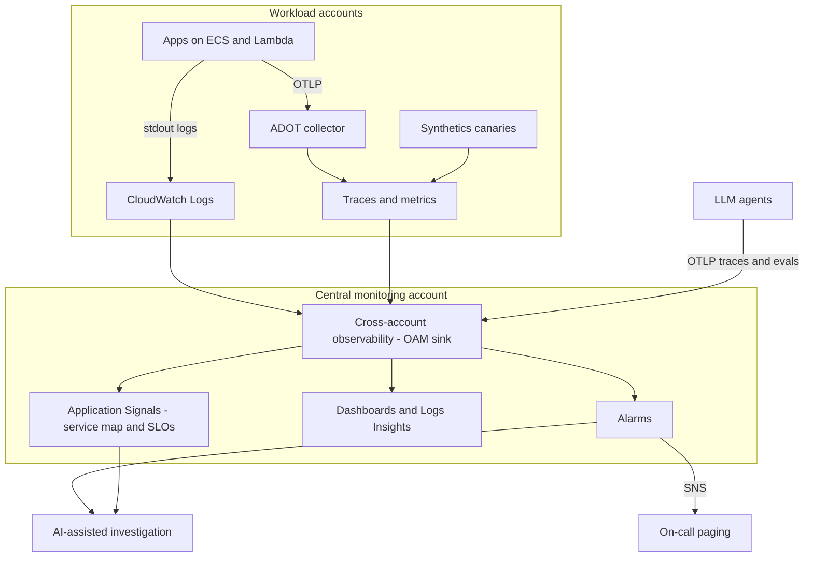

## The scenario

A fintech runs 60 services across 12 AWS accounts, and last quarter's worst outage took four hours to diagnose. The on-call engineer opened dashboards in three accounts, grepped logs in two Regions, and still could not tell which upstream dependency started the failure. Leadership wants **a mean time to detect under five minutes, a single place to investigate across accounts, and SLO-based alerting instead of 400 noisy threshold alarms**. A new requirement has just landed: the team is shipping LLM-powered agents, and nobody can explain why an agent gave a bad answer.

## Requirements breakdown

- **Detect before customers do** — alerts fire on user-facing symptoms (error rate, latency, availability), not on every CPU spike.
- **One investigation surface across accounts** — telemetry from workload accounts is visible from a central place without copying data by hand.
- **Correlate the three signals** — metrics tell you something is wrong, logs say what, and traces say where in the call path.
- **SLO-driven alerting** — error budgets and burn rates replace static thresholds on the critical user journeys.
- **Agent and LLM observability** — prompts, model calls, and tool invocations are traceable, and answer quality is measurable.
- **Predictable telemetry cost** — retention, sampling, and log volume are managed deliberately, not discovered on the bill.

## Recommended design

## Solution walkthrough

- **Instrument once, with OpenTelemetry.** Applications emit traces and metrics through the AWS Distro for OpenTelemetry (ADOT) collector, and logs go to CloudWatch Logs. Standardizing on OpenTelemetry keeps the instrumentation portable — if the backend changes later, the application code does not.
- **Centralize with CloudWatch cross-account observability.** A central *monitoring account* is linked to the workload *source accounts* through the Observability Access Manager (OAM). The monitoring account can then query metrics, logs, and traces from all linked accounts in one place, without duplicating the data. Links are rolled out with the same infrastructure-as-code pipeline as the accounts themselves, following the [multi-account landing zone](../../architectures/multi-account) pattern.
- **Application Signals for the service map and SLOs.** Service discovery and a dependency map answer "what calls what", and SLOs on the critical journeys (checkout success, login latency) give burn-rate alarms that page only when the error budget is genuinely at risk.
- **Alarm on symptoms, investigate on causes.** A small number of SLO and symptom alarms page a human through SNS; the rest of the signals (CPU, queue depth, saturation) stay on dashboards and in composite alarms that add context rather than noise. Synthetic canaries cover journeys that have no organic traffic at 3 a.m.
- **A layer for AI-assisted investigation.** AWS has begun layering AI investigation on top of CloudWatch data — see the Omni section below. Whatever the tool, the foundation is the same: clean telemetry, a trustworthy service map, and well-chosen alarms.
- **Agent observability as a first-class signal.** For LLM agents, trace every prompt, model call, and tool invocation, and attach evaluation scores (correctness, tool selection, retrieval quality) to the traces. Without that, "the agent gave a bad answer" is not debuggable.

## A newer option: Amazon CloudWatch Omni

AWS announced **Amazon CloudWatch Omni** in September 2026 as an AI-powered observability experience for applications and AI agents. Based on AWS's launch posts, it works like this:

- It is a separate web experience outside the AWS Console, accessed through a team URL with IAM Identity Center single sign-on.
- A **Space** groups the applications a team owns and points at existing CloudWatch logs, metrics, traces, and alarms without moving the data. It extends CloudWatch rather than replacing it, and existing alarms, dashboards, and APIs keep working.
- It discovers services from telemetry and AWS Config resource discovery, maps dependencies, and starts investigation sessions with topology and correlated signals as context. **AWS DevOps Agent** performs root-cause correlation within those sessions.
- For agents, it provides trace exploration and evaluators, and Amazon Bedrock AgentCore agents are observed with their existing instrumentation. OpenTelemetry (OTLP) is the ingestion path for other frameworks, and Azure is the one additional cloud source mentioned at launch.
- A free IDE extension for VS Code, Cursor, and Kiro supports local agent debugging without an AWS account.
- Pricing is based on telemetry sent and stored; dashboards and alerts carry no additional charge, and query volume up to five times monthly ingestion is free, per AWS's launch post. Confirm current numbers on the CloudWatch pricing page.


Omni is new, and some details are not settled in the launch material: Regional availability was reported secondhand, and the launch posts do not describe how multiple AWS accounts are connected. Treat the [official documentation](https://docs.aws.amazon.com/cloudwatch-omni/latest/APIReference/Welcome.md) as the source of truth before designing around it, and analyst commentary has raised lock-in and telemetry cost as open questions.


The durable lesson for interviews is the layering: **standard instrumentation, a central data plane, SLO-based alerting, and an investigation layer on top.** Omni is one candidate for the top layer, and the lower layers stay valuable whichever tool sits above them.

## Options compared

| Approach | Strengths | Trade-offs | When it fits |
|---|---|---|---|
| CloudWatch native with cross-account observability | No extra vendor, data stays in AWS, Application Signals for SLOs | Investigation across many signals is manual; UI spans several console pages | Default for AWS-centric teams starting out |
| CloudWatch Omni on top of CloudWatch | AI-assisted investigation, app-centric topology, agent tracing and evaluation | Very new; Regional availability and cost behavior still maturing; AWS-specific experience | Teams already on CloudWatch that want faster triage and have agent workloads |
| Amazon Managed Prometheus plus Managed Grafana | Open-source ecosystem, strong for Kubernetes metrics, familiar PromQL and dashboards | Logs and traces need other services; more components to operate | Kubernetes-heavy shops with existing Prometheus skills |
| Third-party SaaS platform | Mature UX, broad integrations, multi-cloud | Per-host or per-GB pricing at scale, data leaves the account | Multi-cloud estates or organizations already standardized on a vendor |

## Pitfalls seen in real projects

- **Alarm sprawl.** Hundreds of static CPU and memory alarms train the on-call team to ignore pages. Page on SLO burn and user-facing symptoms; keep resource metrics as supporting context.
- **Logs without structure or correlation IDs.** Unstructured text logs cannot be joined to traces. Emit JSON logs with trace and request IDs from day one.
- **Unbounded log retention and verbose debug logging in production.** CloudWatch Logs ingestion is often the surprise line item. Set retention per log group, sample high-volume debug logs, and review the top ingesters monthly alongside [cost optimization](cost-optimization).
- **Monitoring that lives in the failing account or Region.** If the dashboards and alarms sit in the same blast radius as the workload, they disappear during the incident. Centralize in a separate monitoring account and test the paging path.
- **Instrumenting agents only at the HTTP boundary.** Seeing a 200 response from an agent says nothing about whether the answer was right. Trace model and tool calls, and score outputs against evaluators.
- **Adopting a new tool before fixing the signals.** An AI investigator on top of unstructured logs, missing traces, and noisy alarms produces confident-sounding noise. Fix instrumentation first.

## How to talk about this in an interview

"I redesigned monitoring for a 12-account platform where diagnosis took hours because telemetry was scattered. We standardized on OpenTelemetry instrumentation, linked all workload accounts to a central monitoring account with CloudWatch cross-account observability, and used Application Signals to build the service map and SLOs on the critical user journeys. Paging moved from hundreds of threshold alarms to a handful of SLO burn-rate alerts, and detection time dropped from tens of minutes to under five. For the new LLM agents we traced every model and tool call and attached evaluation scores to the traces. I have also evaluated CloudWatch Omni as an AI-assisted investigation layer on top of that foundation — my take is that it is promising, but the value depends on the quality of the underlying telemetry, so the instrumentation and alarm design come first."


Use the interview paragraph truthfully. If you built this as a lab rather than in production, say so, and describe what you measured. See the [Career Toolkit](../../career/) for how to phrase lab experience honestly.


## Related content

- Architecture reference: [Multi-Account Landing Zone](../../architectures/multi-account) — where the monitoring account lives; [Event-Driven](../../architectures/event-driven) — queue depth, DLQ, and age-of-oldest-message are the key signals there.
- Related playbooks: [CI/CD on AWS](cicd) — the alarms that gate automatic rollback come from this observability foundation; [Security & Compliance](security-compliance) — CloudTrail and GuardDuty findings are also telemetry; [Cost Optimization](cost-optimization) — telemetry volume is a cost lever.
- Build it: [Lab 04 — Event-Driven Pipeline](../../labs/lab-04-event-driven) produces retries and DLQ messages worth alarming on, and [Lab 01 — Three-Tier Web Application](../../labs/lab-01-three-tier-web) gives you an ALB and Auto Scaling group to build a dashboard and SLO-style alarms around.
